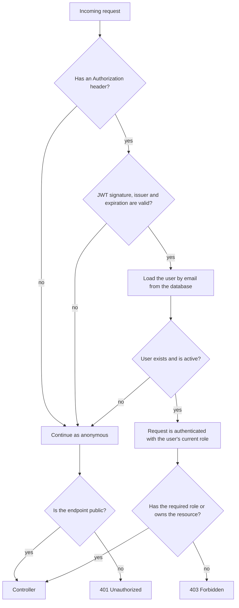
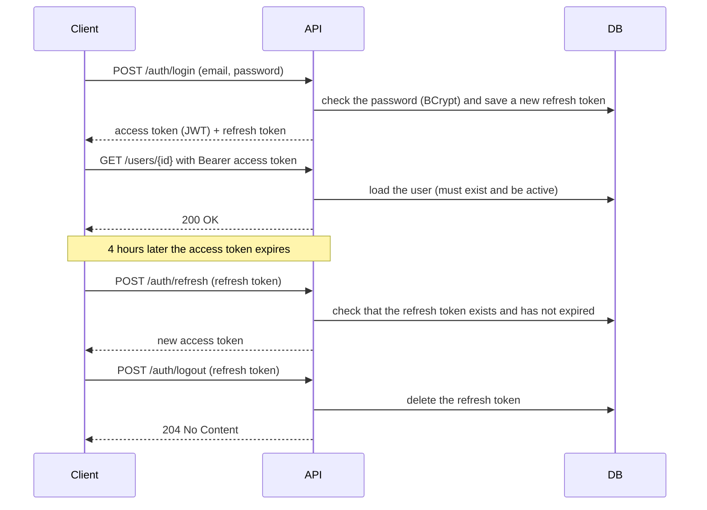
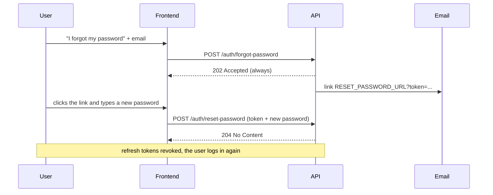

# Spring Auth Boilerplate

**English** | [Português](README.pt-BR.md)


A ready-to-use API for authentication and user management, built with **Spring Boot 3** and **Spring Security**. It is meant as the starting point for a new backend. Users can:

- sign up and log in with JWT;
- stay logged in with refresh tokens;
- log out from one device or from all of them;
- reset a forgotten password by email.

Admins manage accounts and roles.

## Table of contents

- [Features](#features)
- [Tech stack](#tech-stack)
- [How authentication works](#how-authentication-works)
- [Roles and permissions](#roles-and-permissions)
- [When sessions are revoked](#when-sessions-are-revoked)
- [Password reset flow](#password-reset-flow)
- [Business rules](#business-rules)
- [Design decisions](#design-decisions)
- [Getting started](#getting-started)
- [Trying the API](#trying-the-api)
- [API reference](#api-reference)
- [Error responses](#error-responses)
- [Configuration](#configuration)
- [Tests](#tests)
- [Project structure](#project-structure)
- [Known limitations and next steps](#known-limitations-and-next-steps)
- [Author](#author)

## Features

- **JWT authentication:** access tokens signed with HMAC256, sent as `Authorization: Bearer <token>`.
- **Refresh tokens stored in the database:** log out from one device (`/auth/logout`) or from all devices (`/auth/logout-all`).
- **Automatic session revocation:** refresh tokens are revoked when the password, email or role changes, when the account is deactivated, and after a password reset.
- **Password reset by email:** the user receives a link to the reset page. The token is never returned by the API, and the endpoint gives the same response whether the email is registered or not.
- **Role-based access control:** `USER` and `ADMIN` roles, plus an ownership rule (users can only see and edit their own profile).
- **Admin safeguard:** the last active administrator cannot be deleted, deactivated or demoted.
- **Scheduled cleanup:** expired refresh tokens are deleted every day at 03:00.
- **Standard error format:** errors are returned as JSON with the same fields (`timestamp`, `status`, `error`, `message`, `path`).
- **Interactive docs:** Swagger UI with JWT authentication already configured.

## Tech stack

| Technology | Used for |
|---|---|
| Java 21 | Language |
| Spring Boot 3.5 | Application framework |
| Spring Security | Security filter chain, access rules, BCrypt password hashing |
| Spring Data JPA / Hibernate | Persistence |
| PostgreSQL 16 | Database |
| auth0 java-jwt | Creating and validating JWTs |
| Spring Mail + Mailpit | Sending password reset emails (Mailpit catches them locally) |
| springdoc-openapi | Swagger UI and OpenAPI documentation |
| JUnit 5, Mockito, MockMvc, H2 | Automated tests |
| Docker / Docker Compose | Local environment |
| GitHub Actions | Continuous integration |

## How authentication works

The API uses two tokens, each with a different job:

| | Access token | Refresh token |
|---|---|---|
| Format | JWT signed with HMAC256 using `JWT_SECRET` | Random UUID |
| What it contains | The user's email (`sub`), the issuer and the expiration date | Nothing, it is only an identifier |
| Lifetime | 4 hours | 7 days |
| Stored on the server | No | Yes, in the `users_refresh_tokens` table |
| Where it is sent | In every request: `Authorization: Bearer <token>` | Only to `/auth/refresh` and `/auth/logout` |
| Can be revoked | No, it is valid until it expires | Yes, by deleting it from the database |

The access token isn't stored anywhere, so the API keeps no session in memory (`SessionCreationPolicy.STATELESS`) and any instance of the API can validate it. The refresh token is stored, so each session (each device that logged in) can be ended on its own.

### What happens on each request



1. `SecurityFilter` runs before Spring Security's own filters. It reads the `Authorization` header and asks `TokenService` to validate the JWT.
2. If the token is valid, the filter loads the user from the database using the email in the token. Deleted or deactivated users are not authenticated, even with a token that hasn't expired.
3. `SecurityConfig` decides which endpoints are public. The other endpoints require authentication.
4. Endpoint-specific rules use `@PreAuthorize`, for example `@authorizationService.isOwner(#id) or hasRole('ADMIN')`.

The role is never read from the token. It always comes from the database, so a role change takes effect on the next request.

### Login, refresh and logout



A wrong password and a deactivated account both return `401` with the same message (`Incorrect email or password`).

## Roles and permissions

- Every new user gets the `USER` role.
- `ADMIN` has the permissions of `ADMIN` and of `USER`.
- The first admin is created when the application starts, from the `ADMIN_NAME`, `ADMIN_EMAIL` and `ADMIN_PASSWORD` variables, if no user with that email exists yet.
- **Ownership rule:** a user can only read and update their own profile. Admins can do it for any user.

| Action | Anonymous | USER | ADMIN |
|---|:---:|:---:|:---:|
| Sign up, log in, refresh token, forgot/reset password | ✅ | ✅ | ✅ |
| Log out (one session or all) | ❌ | ✅ | ✅ |
| View and update **own** profile | ❌ | ✅ | ✅ |
| View and update **other users'** profiles | ❌ | ❌ | ✅ |
| List all users | ❌ | ❌ | ✅ |
| Activate, deactivate, change role, delete | ❌ | ❌ | ✅ |

## When sessions are revoked

| Event | Refresh tokens | Access tokens already issued |
|---|---|---|
| Logout | The refresh token sent is deleted | Keep working until they expire |
| Logout from all devices | All of the user's are deleted | Keep working until they expire |
| Password change (`PUT /users/{id}`) | All deleted | Keep working until they expire |
| Password reset | All deleted | Keep working until they expire |
| Email change | All deleted | **Stop working immediately** (the email in the token no longer matches a user) |
| Role change | All deleted | Keep working, already with the **new role** |
| Account deactivated | All deleted | **Stop working immediately** |
| Account deleted | All deleted | **Stop working immediately** |

Access tokens that "keep working until they expire" are the trade-off of stateless JWTs: the server has no record of them, so it can't cancel them. That's why access tokens should be short-lived (see [Known limitations](#known-limitations-and-next-steps)).

## Password reset flow



1. The client sends the email to `POST /auth/forgot-password`. The API **always** answers `202 Accepted`, so nobody can use this endpoint to find out which emails are registered.
2. If the account exists, the API saves a reset token and emails a link such as `http://localhost:3000/reset-password?token=<token>`. The email is sent in the background (`@Async`), and a delivery failure is logged without changing the response.
3. The frontend page reads `token` from the URL and sends it with the new password to `POST /auth/reset-password`.
4. The API checks that the token exists, hasn't expired (10 minutes) and hasn't been used. Then it changes the password, marks the token as used and revokes every refresh token. The user logs in again with the new password.

The link's base address comes from `RESET_PASSWORD_URL`, so any frontend can provide the "new password" page.

**Trying it without a frontend:** this repository is backend only. Run the flow above in Swagger, open Mailpit at http://localhost:8025, copy the `token` from the link in the email, and send it to `POST /auth/reset-password`:

```json
{ "resetToken": "<token from the link>", "newPassword": "newSecret123" }
```

## Business rules

- **Unique email:** signing up or changing to an email that is already in use returns `400`.
- **Password:** at least 6 characters. It is stored as a BCrypt hash and never returned by the API.
- **Name:** required on sign-up, at most 100 characters.
- **Partial update:** `PUT /users/{id}` changes only the fields you send (`name`, `email`, `password`).
- **At least one active admin:** deleting, deactivating or demoting the last active admin returns `400`.
- **Deactivated accounts** can't log in, and their access tokens stop working right away.
- **Expired refresh tokens** are deleted when someone tries to use them (`400`) and by a daily job at 03:00.
- **Reset tokens** expire after 10 minutes and can be used only once.

## Design decisions

| Decision | Why |
|---|---|
| Access token is stateless; refresh token is stored in the database | The API keeps no HTTP session. Only refresh tokens are persisted, so long-lived sessions can be revoked one by one. |
| The user is loaded from the database on every request | Role changes and deactivation take effect immediately, not only when the JWT expires. The role is never trusted from the token. |
| Sensitive changes revoke every refresh token | A stolen session can't survive a password change, password reset, role change or deactivation. |
| `forgot-password` always returns `202` and sends a link by email | Returning the token would let anyone reset any account. A different response for unknown emails would reveal which accounts exist. |
| The reset link points to a configurable URL | The API doesn't depend on a specific frontend. Any client can read `?token=` and call `POST /auth/reset-password`. |
| Email is sent with `@Async` | The request doesn't wait for the SMTP server, which also keeps response times similar for registered and unregistered emails. |
| The admin rule counts only **active** admins | Deactivating admins one by one must not leave the system without an administrator. |
| One JSON error format for the whole API | Clients handle every error the same way, and internal details (stack traces) only go to the server log. |

## Getting started

### Requirements

- [Docker](https://docs.docker.com/get-docker/) with Docker Compose. This is all you need to run the API, because the build happens inside Docker.
- JDK 21, only to run without Docker or to run the tests.

### 1. Clone the repository

```bash
git clone https://github.com/TiagoPaulin/Spring_Auth_Boilerplate.git
cd Spring_Auth_Boilerplate
```

### 2. Create the `.env` file

```bash
cp .env.example .env
```

Open `.env` and fill in the values. Each variable is explained in [Configuration](#configuration). To generate a good `JWT_SECRET`:

```bash
openssl rand -base64 48
```

`.env` is in `.gitignore`, so your secrets are not committed.

### 3. Start everything

```bash
docker compose up --build
```

This starts three containers:

| Container | What it is | Address |
|---|---|---|
| `springauth-api` | The API | http://localhost:8080 |
| | Swagger UI | http://localhost:8080/swagger-ui.html |
| `springauth-postgres` | PostgreSQL | `localhost:5432` |
| `springauth-mailpit` | Fake SMTP server with a web inbox | http://localhost:8025 |

The API is ready when the log shows `Started SpringauthApplication`. The admin from `.env` already exists at that point.

### Stopping and resetting

```bash
docker compose down      # stop the containers, keep the data
docker compose down -v   # stop and delete the database (the admin is created again on the next start)
```

### Running from the IDE or with Maven

Start only the database and Mailpit in Docker, load the variables from `.env` and run the application:

```bash
docker compose up -d postgres-db mailpit
set -a && source .env && set +a
./mvnw spring-boot:run
```

In an IDE, set the same variables from `.env` in the run configuration of `SpringauthApplication`.

## Trying the API

### With Swagger UI

1. Open http://localhost:8080/swagger-ui.html.
2. Open `POST /auth/login`, click **Try it out**, enter the `ADMIN_EMAIL` and `ADMIN_PASSWORD` from your `.env` and click **Execute**.
3. Copy the `token` value from the response.
4. Click **Authorize** (top right), paste the token **without** the `Bearer ` prefix and confirm.
5. Now you can call the protected endpoints, for example `GET /users`.
6. When the access token expires, call `POST /auth/refresh` with the `refreshToken` to get a new one.

### With curl

```bash
# 1. Sign up a user
curl -i -X POST http://localhost:8080/users \
  -H "Content-Type: application/json" \
  -d '{"name":"Tiago","email":"tiago@example.com","password":"secret123"}'

# 2. Log in
curl -X POST http://localhost:8080/auth/login \
  -H "Content-Type: application/json" \
  -d '{"email":"tiago@example.com","password":"secret123"}'
# {"token":"eyJhbGciOi...","refreshToken":"550e8400-..."}

# 3. Save the tokens in variables
TOKEN="<token>"
REFRESH="<refreshToken>"

# 4. Read your own profile (on a new database the admin is id 1 and this user is id 2)
curl http://localhost:8080/users/2 -H "Authorization: Bearer $TOKEN"

# 5. Get a new access token
curl -X POST http://localhost:8080/auth/refresh \
  -H "Content-Type: application/json" \
  -d "{\"refreshToken\":\"$REFRESH\"}"

# 6. Log out from this session
curl -X POST http://localhost:8080/auth/logout \
  -H "Authorization: Bearer $TOKEN" \
  -H "Content-Type: application/json" \
  -d "{\"refreshToken\":\"$REFRESH\"}"
```

## API reference

The full request and response schemas are in Swagger UI. This is a summary.

### Authentication (`/auth`)

| Method | Endpoint | Access | Request body | Success response |
|---|---|---|---|---|
| `POST` | `/auth/login` | Public | `email`, `password` | `200` with `token` and `refreshToken` |
| `POST` | `/auth/refresh` | Public | `refreshToken` | `200` with a new `token` (the `refreshToken` stays the same) |
| `POST` | `/auth/logout` | Authenticated | `refreshToken` | `204` |
| `DELETE` | `/auth/logout-all` | Authenticated | none | `204` |
| `POST` | `/auth/forgot-password` | Public | `email` | `202`, always |
| `POST` | `/auth/reset-password` | Public | `resetToken`, `newPassword` | `204` |

### Users (`/users`)

| Method | Endpoint | Access | Request body | Success response |
|---|---|---|---|---|
| `POST` | `/users` | Public | `name`, `email`, `password` | `201` with the user and a `Location` header |
| `GET` | `/users` | Admin | none (query: `page`, `size`, `sort`) | `200` with a page of users |
| `GET` | `/users/{id}` | Owner or admin | none | `200` with the user |
| `PUT` | `/users/{id}` | Owner or admin | any of `name`, `email`, `password` | `200` with the updated user |
| `DELETE` | `/users/{id}` | Admin | none | `204` |
| `PATCH` | `/users/{id}/activate` | Admin | none | `204` |
| `PATCH` | `/users/{id}/deactivate` | Admin | none | `204` |
| `PATCH` | `/users/{id}/role` | Admin | `role` (`USER` or `ADMIN`) | `204` |

Example of a user in the responses:

```json
{
  "id": 2,
  "name": "Tiago",
  "email": "tiago@example.com",
  "role": "USER",
  "active": true,
  "createdAt": "2026-10-25T18:00:00",
  "updatedAt": "2026-10-25T18:00:00"
}
```

Paginated list example: `GET /users?page=0&size=10&sort=name,asc`. The default page size is 20.

## Error responses

Errors use the same JSON body:

```json
{
  "timestamp": "2026-10-25T18:00:00Z",
  "status": 400,
  "error": "Validation error",
  "message": "password: Password must be at least 6 characters long; ",
  "path": "/users/2"
}
```

| Status | When it happens |
|---|---|
| `400` | Invalid or malformed body, invalid parameter (e.g. `/users/abc`), email already in use, expired or used refresh/reset token, last active admin rule |
| `401` | Missing, invalid or expired access token, wrong email or password, deactivated account at login |
| `403` | Authenticated, but without permission (e.g. a `USER` reading another user's profile) |
| `404` | User, refresh token or reset token not found, or the route doesn't exist |
| `405` | HTTP method not supported by the route |
| `500` | Unexpected error. The client gets a generic message, and the details go to the server log |

## Configuration

### Environment variables

| Variable | Required | Default | Description |
|---|:---:|---|---|
| `DB_NAME` | ✅ | | PostgreSQL database name |
| `DB_USER` | ✅ | | PostgreSQL user |
| `DB_PASSWORD` | ✅ | | PostgreSQL password |
| `JWT_SECRET` | ✅ | | Secret used to sign access tokens. Changing it invalidates every access token already issued |
| `ADMIN_NAME` | ✅ | | Name of the admin created at startup |
| `ADMIN_EMAIL` | ✅ | | Email (login) of the admin created at startup |
| `ADMIN_PASSWORD` | ✅ | | Password of the admin created at startup |
| `MAIL_HOST` | | `localhost` | SMTP server (inside Docker Compose: `mailpit`) |
| `MAIL_PORT` | | `1025` | SMTP port |
| `MAIL_FROM` | | `no-reply@springauth.local` | Sender of the emails |
| `RESET_PASSWORD_URL` | | `http://localhost:3000/reset-password` | Frontend page used in the reset link |

The admin is only created when no user with `ADMIN_EMAIL` exists. Changing `ADMIN_PASSWORD` later doesn't change the password of an admin that already exists.

To use a real SMTP provider instead of Mailpit, also set `SPRING_MAIL_USERNAME` and `SPRING_MAIL_PASSWORD`, which Spring Boot reads automatically.

### Token lifetimes

They are set in `src/main/resources/application.properties`:

| Property | Default | Meaning |
|---|---|---|
| `api.security.token.expiration` | `4` | Access token lifetime, in hours |
| `api.security.refresh.expiration` | `7` | Refresh token lifetime, in days |
| `api.security.reset-password.expiration` | `10` | Reset link lifetime, in minutes |

### CORS

`SecurityConfig` accepts requests from any origin (`*`) to make local development easier. In production, replace `*` with your frontend's address.

## Tests

```bash
./mvnw test                        # all tests
./mvnw test -Dtest=UserServiceTest # a single test class
```

The tests need JDK 21 and nothing else. They use an in-memory H2 database and the `test` profile, which has its own values in `src/test/resources/application-test.properties`, so no environment variables are needed.

| Type | Tools | What it checks | Examples |
|---|---|---|---|
| Unit | JUnit 5 + Mockito | Business rules, JWT creation and validation, the security filter, email content | `UserServiceTest`, `TokenServiceTest`, `SecurityFilterTest`, `MailServiceTest` |
| Web layer | MockMvc + `@SpringBootTest` | HTTP status codes, validation, who can call each endpoint, error format | `AuthControllerTest`, `UserControllerTest` |
| Persistence | `@DataJpaTest` | Custom repository queries | `UserRepositoryTest`, `RefreshTokenRepositoryTest` |
| Integration | `@SpringBootTest` + H2 | Flows that depend on real database constraints, such as deleting a user who has tokens | `UserServiceIntegrationTest` |

GitHub Actions (`.github/workflows/pipeline.yml`) runs the tests and builds the application on every push and pull request to `main`.

## Project structure

```
.
├── .github/workflows/pipeline.yml      # CI: tests + build
├── docker-compose.yml                  # PostgreSQL, Mailpit and the API
├── Dockerfile                          # Multi-stage build (Maven → JRE 21)
├── .env.example                        # Template for the environment variables
└── src
    ├── main/java/com/boilerplate/springauth
    │   ├── config/
    │   │   ├── SecurityConfig.java              # Filter chain, public routes, CORS, BCrypt
    │   │   ├── SwaggerConfig.java               # OpenAPI info and bearer scheme
    │   │   └── InsertDatabaseConfig.java        # Creates the admin at startup
    │   ├── controllers/
    │   │   ├── AuthController.java              # /auth endpoints
    │   │   └── UserController.java              # /users endpoints
    │   ├── dto/                                 # Request and response records with validation
    │   ├── exceptions/                          # Custom exceptions and GlobalExceptionHandler
    │   ├── models/                              # User, RefreshToken, ResetPasswordToken, Role
    │   ├── repositories/                        # Spring Data JPA repositories
    │   ├── security/
    │   │   ├── SecurityFilter.java              # Reads and validates the JWT on every request
    │   │   ├── TokenService.java                # Creates and validates JWTs
    │   │   ├── RefreshTokenService.java         # Creates, validates and revokes refresh tokens
    │   │   ├── AuthorizationService.java        # isOwner(), used in @PreAuthorize
    │   │   └── CustomAuthenticationEntryPoint.java  # JSON body for 401 responses
    │   └── services/
    │       ├── AuthService.java                 # Loads users for Spring Security
    │       ├── UserService.java                 # User rules: unique email, last admin, revocation
    │       ├── ResetPasswordTokenService.java   # Forgot and reset password
    │       └── MailService.java                 # Sends the reset email
    └── test/                                    # Same package layout as main
```

### Database tables

| Table | What it stores |
|---|---|
| `users` | Name, email (unique), BCrypt password hash, role, active flag, creation and update dates |
| `users_refresh_tokens` | Refresh token, owner and expiration date |
| `users_reset_password_tokens` | Reset token, owner, expiration date and whether it was already used |

Hibernate creates and updates the tables automatically (`spring.jpa.hibernate.ddl-auto=update`).

## Author

**Tiago Paulin** · tiagopaulin.dev@gmail.com
