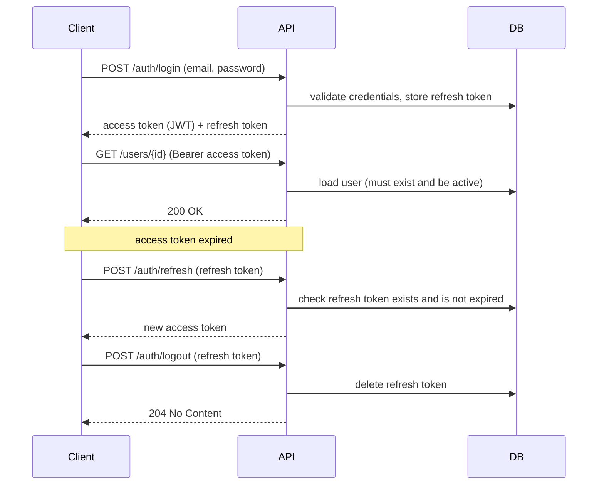

# Spring Auth Boilerplate


A REST API that handles authentication and user management with **Spring Boot 3** and **Spring Security**. It uses stateless JWT access tokens and refresh tokens stored in the database, so sessions can be revoked. It includes role-based authorization, password reset by email, and account activation.

## Features

- **JWT authentication:** access tokens (HMAC256) sent as `Authorization: Bearer <token>`.
- **Refresh tokens stored in the database:** logout from one device (`/auth/logout`) or from all devices (`/auth/logout-all`).
- **Automatic session revocation:** all refresh tokens are revoked when the password, email or role changes, when the account is deactivated, or after a password reset.
- **Password reset by email:** the user receives a link to the frontend reset page (`RESET_PASSWORD_URL?token=...`). The token is never returned by the API, and the endpoint gives the same response whether the email exists or not.
- **Role-based access control:** `USER` / `ADMIN`, with ownership rules (`@PreAuthorize("@authorizationService.isOwner(#id) or hasRole('ADMIN')")`).
- **Admin safeguard:** the last active administrator cannot be deleted, deactivated or demoted.
- **Scheduled cleanup:** expired refresh tokens are deleted every day at 03:00.
- **Consistent error responses:** validation, business-rule, authentication and routing errors (400/401/404/405) return the same JSON body.
- **OpenAPI docs:** Swagger UI with the bearer scheme already configured.

## Tech stack

Java 21 · Spring Boot 3.5 · Spring Security · Spring Data JPA · PostgreSQL 16 · auth0 java-jwt · springdoc-openapi · Spring Mail · JUnit 5 · Mockito · MockMvc · H2 (tests) · Docker · GitHub Actions

## Authentication flow



## Design decisions

| Decision | Why |
|---|---|
| Access token is stateless; refresh token is stored in the database | The API keeps no HTTP session. Only refresh tokens are persisted, so long-lived sessions can be revoked one by one. |
| The user is loaded from the database on every request | Role changes and deactivation take effect immediately, not only when the JWT expires. The role is not trusted from the token. |
| Sensitive changes revoke every refresh token | A leaked session can't survive a password change, password reset, role change or deactivation. |
| `forgot-password` always returns `202` and sends a reset link by email | Returning the token would let anyone reset any account. A different response for unknown emails would reveal which accounts exist. |
| The reset link points to a configurable frontend URL | The API stays frontend-agnostic. Any client can provide the "new password" page, read `?token=` and call `POST /auth/reset-password`. |
| Email is sent with `@Async` | The request doesn't wait for the SMTP server, which also keeps response times similar for registered and unregistered emails. |
| The admin rule counts only **active** admins | Deactivating admins one by one must not leave the system without an administrator. |

## Getting started

### Requirements

- Docker and Docker Compose
- JDK 21 (only to run outside Docker or to run the tests)

### Run with Docker

```bash
cp .env.example .env   # then edit the values
docker compose up --build
```

| Service | URL |
|---|---|
| API | http://localhost:8080 |
| Swagger UI | http://localhost:8080/swagger-ui.html |
| Mailpit (inbox for reset emails) | http://localhost:8025 |

The admin account defined by `ADMIN_EMAIL` / `ADMIN_PASSWORD` is created on first startup.

### Run from the IDE / Maven

```bash
docker compose up -d postgres-db mailpit
set -a && source .env && set +a
./mvnw spring-boot:run
```

### Environment variables

| Variable | Description |
|---|---|
| `DB_NAME`, `DB_USER`, `DB_PASSWORD` | PostgreSQL database and credentials |
| `JWT_SECRET` | Secret used to sign access tokens |
| `ADMIN_NAME`, `ADMIN_EMAIL`, `ADMIN_PASSWORD` | Admin account created at startup |
| `MAIL_HOST`, `MAIL_PORT`, `MAIL_FROM` | SMTP settings (default: Mailpit on `localhost:1025`) |
| `RESET_PASSWORD_URL` | Frontend page used in the reset email link (default: `http://localhost:3000/reset-password`) |

Token lifetimes are set in `application.properties`: access token **4 h**, refresh token **7 days**, reset token **10 min**.

## API overview

| Method | Endpoint | Access | Description |
|---|---|---|---|
| `POST` | `/users` | Public | Register a new user |
| `POST` | `/auth/login` | Public | Get access and refresh tokens |
| `POST` | `/auth/refresh` | Public | Get a new access token |
| `POST` | `/auth/forgot-password` | Public | Send a reset token by email (`202`) |
| `POST` | `/auth/reset-password` | Public | Set a new password using the reset token |
| `POST` | `/auth/logout` | Authenticated | Revoke one refresh token |
| `DELETE` | `/auth/logout-all` | Authenticated | Revoke all of the user's refresh tokens |
| `GET` | `/users/{id}` | Owner or Admin | Get a user profile |
| `PUT` | `/users/{id}` | Owner or Admin | Update name, email or password |
| `GET` | `/users` | Admin | List users (paginated) |
| `DELETE` | `/users/{id}` | Admin | Delete a user |
| `PATCH` | `/users/{id}/activate` | Admin | Activate an account |
| `PATCH` | `/users/{id}/deactivate` | Admin | Deactivate an account |
| `PATCH` | `/users/{id}/role` | Admin | Change a user's role |

Full request and response schemas are in Swagger UI.

### Quick example

```bash
# register
curl -X POST localhost:8080/users -H "Content-Type: application/json" \
  -d '{"name":"Tiago","email":"tiago@example.com","password":"secret123"}'

# login
curl -X POST localhost:8080/auth/login -H "Content-Type: application/json" \
  -d '{"email":"tiago@example.com","password":"secret123"}'
# => {"token":"eyJhbGciOi...","refreshToken":"550e8400-..."}

# call a protected endpoint
curl localhost:8080/users/2 -H "Authorization: Bearer <token>"
```

### Password reset flow

1. The client calls `POST /auth/forgot-password` with the user's email. The API always answers `202 Accepted`.
2. If the account exists, the user receives an email with a link such as `http://localhost:3000/reset-password?token=<token>`. The link expires in 10 minutes.
3. The frontend page reads the `token` from the URL and sends it with the new password to `POST /auth/reset-password`.
4. The API changes the password, invalidates the link and revokes every refresh token, so the user logs in again with the new password.

This repository is backend only. To try the flow without a frontend, open Mailpit at http://localhost:8025, copy the `token` from the link, and call `POST /auth/reset-password` in Swagger:

```json
{ "resetToken": "<token from the link>", "newPassword": "newSecret123" }
```

### Error format

```json
{
  "timestamp": "2026-10-25T18:00:00Z",
  "status": 400,
  "error": "Validation error",
  "message": "password: Password must be at least 6 characters long; ",
  "path": "/users/2"
}
```

## Tests

```bash
./mvnw test
```

The tests use an in-memory H2 database and need no external services. They include:

- **Unit tests** (Mockito) for services, token handling and the security filter
- **Web layer tests** (MockMvc) for authorization rules, validation and error handling
- **Persistence tests** (`@DataJpaTest`) for custom repository queries
- **Integration tests** (`@SpringBootTest`) for flows that depend on real database constraints

GitHub Actions runs the test suite on pushes and pull requests to `main`.

## Project structure

```
src/main/java/com/boilerplate/springauth
├── config/          # Security, CORS, Swagger, admin seeding
├── controllers/     # REST endpoints
├── dto/             # Request/response records with validation
├── exceptions/      # Custom exceptions and global handler
├── models/          # JPA entities
├── repositories/    # Spring Data repositories
├── security/        # JWT filter, token services, authorization helpers
└── services/        # Business rules, email
```

## Next steps

- Database migrations with Flyway instead of `ddl-auto=update`
- Refresh token rotation and hashing tokens before storing them
- Rate limiting on login and password reset
- End-to-end tests against PostgreSQL with Testcontainers
- Require the current password when changing the password

## Author

**Tiago Paulin** · tiagopaulin.dev@gmail.com
