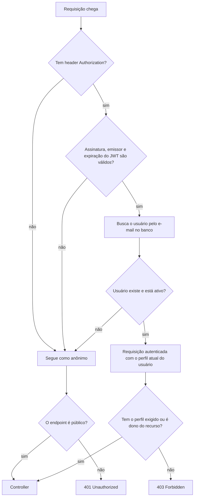
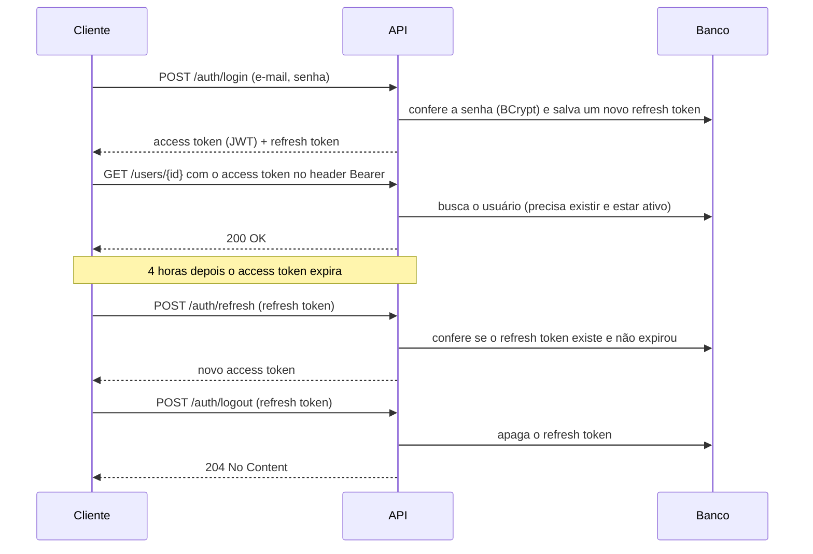
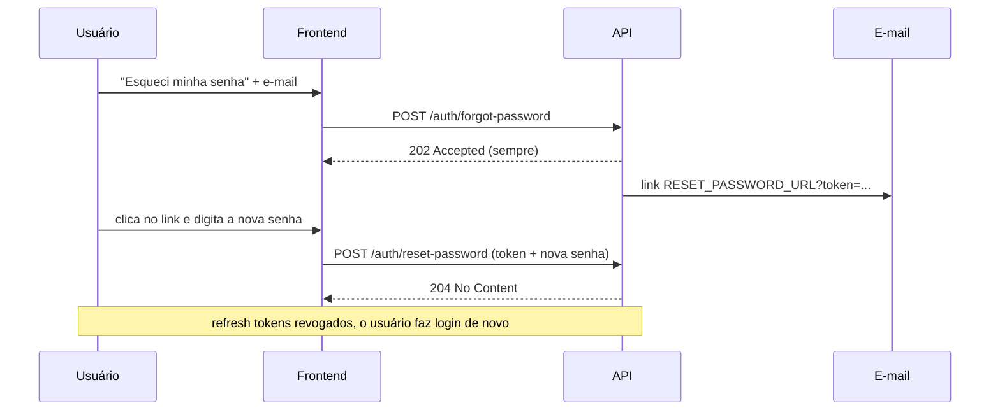

# Spring Auth Boilerplate

[English](README.md) | **Português**


Uma API pronta de autenticação e gerenciamento de usuários, feita com **Spring Boot 3** e **Spring Security**. A ideia é servir de ponto de partida para um backend novo. Os usuários podem:

- se cadastrar e fazer login com JWT;
- continuar logados com refresh tokens;
- sair de um dispositivo ou de todos;
- recuperar a senha esquecida por e-mail.

Os administradores gerenciam contas e perfis de acesso.

## Sumário

- [Funcionalidades](#funcionalidades)
- [Tecnologias](#tecnologias)
- [Como a autenticação funciona](#como-a-autenticação-funciona)
- [Perfis e permissões](#perfis-e-permissões)
- [Quando as sessões são revogadas](#quando-as-sessões-são-revogadas)
- [Fluxo de redefinição de senha](#fluxo-de-redefinição-de-senha)
- [Regras de negócio](#regras-de-negócio)
- [Decisões de design](#decisões-de-design)
- [Como rodar](#como-rodar)
- [Testando a API](#testando-a-api)
- [Referência da API](#referência-da-api)
- [Respostas de erro](#respostas-de-erro)
- [Configuração](#configuração)
- [Testes](#testes)
- [Estrutura do projeto](#estrutura-do-projeto)
- [Limitações conhecidas e próximos passos](#limitações-conhecidas-e-próximos-passos)
- [Autor](#autor)

## Funcionalidades

- **Autenticação com JWT:** access tokens assinados com HMAC256, enviados como `Authorization: Bearer <token>`.
- **Refresh tokens salvos no banco:** logout de um dispositivo (`/auth/logout`) ou de todos (`/auth/logout-all`).
- **Revogação automática de sessões:** os refresh tokens são revogados quando a senha, o e-mail ou o perfil mudam, quando a conta é desativada e depois de uma redefinição de senha.
- **Redefinição de senha por e-mail:** o usuário recebe um link para a página de redefinição. O token nunca é devolvido pela API, e o endpoint responde igual exista o e-mail ou não.
- **Controle de acesso por perfil:** perfis `USER` e `ADMIN`, mais uma regra de dono (o usuário só vê e edita o próprio perfil).
- **Proteção do admin:** o último administrador ativo não pode ser excluído, desativado nem rebaixado.
- **Limpeza agendada:** refresh tokens expirados são apagados todo dia às 03:00.
- **Formato de erro padrão:** os erros voltam em JSON com os mesmos campos (`timestamp`, `status`, `error`, `message`, `path`).
- **Documentação interativa:** Swagger UI com a autenticação JWT já configurada.

## Tecnologias

| Tecnologia | Para que serve no projeto |
|---|---|
| Java 21 | Linguagem |
| Spring Boot 3.5 | Framework da aplicação |
| Spring Security | Cadeia de filtros de segurança, regras de acesso, hash de senha com BCrypt |
| Spring Data JPA / Hibernate | Persistência |
| PostgreSQL 16 | Banco de dados |
| auth0 java-jwt | Criar e validar JWTs |
| Spring Mail + Mailpit | Enviar os e-mails de redefinição de senha (o Mailpit captura os e-mails localmente) |
| springdoc-openapi | Swagger UI e documentação OpenAPI |
| JUnit 5, Mockito, MockMvc, H2 | Testes automatizados |
| Docker / Docker Compose | Ambiente local |
| GitHub Actions | Integração contínua |

## Como a autenticação funciona

A API usa dois tokens, cada um com uma função:

| | Access token | Refresh token |
|---|---|---|
| Formato | JWT assinado com HMAC256 usando o `JWT_SECRET` | UUID aleatório |
| O que contém | O e-mail do usuário (`sub`), o emissor e a data de expiração | Nada, é só um identificador |
| Validade | 4 horas | 7 dias |
| Guardado no servidor | Não | Sim, na tabela `users_refresh_tokens` |
| Onde é enviado | Em toda requisição: `Authorization: Bearer <token>` | Só para `/auth/refresh` e `/auth/logout` |
| Pode ser revogado | Não, vale até expirar | Sim, apagando ele do banco |

Como o access token não fica guardado em lugar nenhum, a API não mantém sessão em memória (`SessionCreationPolicy.STATELESS`) e qualquer instância da API consegue validá-lo. Já o refresh token fica salvo, então cada sessão (cada dispositivo que fez login) pode ser encerrada separadamente.

### O que acontece em cada requisição



1. O `SecurityFilter` roda antes dos filtros do próprio Spring Security. Ele lê o header `Authorization` e pede para o `TokenService` validar o JWT.
2. Se o token for válido, o filtro busca o usuário no banco pelo e-mail que está no token. Usuários excluídos ou desativados não são autenticados, mesmo com um token que ainda não expirou.
3. O `SecurityConfig` define quais endpoints são públicos. Os demais exigem autenticação.
4. Regras específicas de cada endpoint usam `@PreAuthorize`, por exemplo `@authorizationService.isOwner(#id) or hasRole('ADMIN')`.

O perfil nunca é lido do token. Ele sempre vem do banco, então uma mudança de perfil vale já na próxima requisição.

### Login, refresh e logout



Senha errada e conta desativada retornam `401` com a mesma mensagem (`Incorrect email or password`).

## Perfis e permissões

- Todo usuário novo recebe o perfil `USER`.
- `ADMIN` tem as permissões de `ADMIN` e de `USER`.
- O primeiro admin é criado quando a aplicação sobe, a partir das variáveis `ADMIN_NAME`, `ADMIN_EMAIL` e `ADMIN_PASSWORD`, se ainda não existir um usuário com esse e-mail.
- **Regra de dono:** um usuário só pode ver e alterar o próprio perfil. Admins podem fazer isso com qualquer usuário.

| Ação | Anônimo | USER | ADMIN |
|---|:---:|:---:|:---:|
| Cadastro, login, refresh, esqueci/redefinir senha | ✅ | ✅ | ✅ |
| Logout (uma sessão ou todas) | ❌ | ✅ | ✅ |
| Ver e alterar o **próprio** perfil | ❌ | ✅ | ✅ |
| Ver e alterar o perfil de **outros** usuários | ❌ | ❌ | ✅ |
| Listar todos os usuários | ❌ | ❌ | ✅ |
| Ativar, desativar, mudar perfil, excluir | ❌ | ❌ | ✅ |

## Quando as sessões são revogadas

| Evento | Refresh tokens | Access tokens já emitidos |
|---|---|---|
| Logout | O refresh token enviado é apagado | Continuam valendo até expirar |
| Logout de todos os dispositivos | Todos os do usuário são apagados | Continuam valendo até expirar |
| Troca de senha (`PUT /users/{id}`) | Todos apagados | Continuam valendo até expirar |
| Redefinição de senha | Todos apagados | Continuam valendo até expirar |
| Troca de e-mail | Todos apagados | **Param de valer na hora** (o e-mail do token não corresponde mais a nenhum usuário) |
| Mudança de perfil | Todos apagados | Continuam valendo, já com o **perfil novo** |
| Conta desativada | Todos apagados | **Param de valer na hora** |
| Conta excluída | Todos apagados | **Param de valer na hora** |

Os access tokens que "continuam valendo até expirar" são o custo de usar JWT sem estado: o servidor não guarda registro deles, então não tem como cancelá-los. Por isso o access token deve ter validade curta (veja [Limitações conhecidas](#limitações-conhecidas-e-próximos-passos)).

## Fluxo de redefinição de senha



1. O cliente envia o e-mail para `POST /auth/forgot-password`. A API responde **sempre** `202 Accepted`, para que ninguém use esse endpoint para descobrir quais e-mails estão cadastrados.
2. Se a conta existir, a API salva um token de redefinição e manda por e-mail um link como `http://localhost:3000/reset-password?token=<token>`. O e-mail é enviado em segundo plano (`@Async`), e uma falha no envio vai para o log sem mudar a resposta.
3. A página do frontend lê o `token` da URL e envia junto com a nova senha para `POST /auth/reset-password`.
4. A API confere se o token existe, não expirou (10 minutos) e ainda não foi usado. Depois troca a senha, marca o token como usado e revoga todos os refresh tokens. O usuário faz login de novo com a senha nova.

O endereço base do link vem de `RESET_PASSWORD_URL`, então qualquer frontend pode oferecer a página de "nova senha".

**Testando sem frontend:** este repositório é só o backend. Faça o fluxo acima pelo Swagger, abra o Mailpit em http://localhost:8025, copie o `token` do link que chegou no e-mail e envie para `POST /auth/reset-password`:

```json
{ "resetToken": "<token do link>", "newPassword": "novaSenha123" }
```

## Regras de negócio

- **E-mail único:** cadastrar ou trocar para um e-mail que já está em uso retorna `400`.
- **Senha:** no mínimo 6 caracteres. É salva como hash BCrypt e nunca é devolvida pela API.
- **Nome:** obrigatório no cadastro, com no máximo 100 caracteres.
- **Atualização parcial:** o `PUT /users/{id}` altera só os campos enviados (`name`, `email`, `password`).
- **Pelo menos um admin ativo:** excluir, desativar ou rebaixar o último admin ativo retorna `400`.
- **Contas desativadas** não conseguem fazer login, e os access tokens delas param de funcionar na hora.
- **Refresh tokens expirados** são apagados quando alguém tenta usá-los (`400`) e por uma rotina diária às 03:00.
- **Tokens de redefinição** expiram em 10 minutos e só podem ser usados uma vez.

## Decisões de design

| Decisão | Por quê |
|---|---|
| Access token sem estado; refresh token salvo no banco | A API não guarda sessão HTTP. Só os refresh tokens ficam salvos, então as sessões longas podem ser revogadas uma a uma. |
| O usuário é carregado do banco em toda requisição | Mudança de perfil e desativação valem na hora, e não só quando o JWT expira. O perfil nunca é lido do token. |
| Mudanças sensíveis revogam todos os refresh tokens | Uma sessão roubada não sobrevive a uma troca de senha, redefinição de senha, mudança de perfil ou desativação. |
| `forgot-password` sempre responde `202` e manda um link por e-mail | Devolver o token na resposta deixaria qualquer pessoa redefinir a senha de qualquer conta. Uma resposta diferente para e-mails desconhecidos revelaria quais contas existem. |
| O link de redefinição aponta para uma URL configurável | A API não depende de um frontend específico. Qualquer cliente pode ler o `?token=` e chamar `POST /auth/reset-password`. |
| O e-mail é enviado com `@Async` | A requisição não espera o servidor SMTP, o que também deixa o tempo de resposta parecido para e-mails cadastrados e não cadastrados. |
| A regra do admin conta só admins **ativos** | Desativar admins um por um não pode deixar o sistema sem administrador. |
| Um único formato de erro em JSON para a API toda | Os clientes tratam todos os erros do mesmo jeito, e os detalhes internos (stack traces) vão só para o log do servidor. |

## Como rodar

### Pré-requisitos

- [Docker](https://docs.docker.com/get-docker/) com Docker Compose. É tudo o que você precisa para rodar a API, porque o build acontece dentro do Docker.
- JDK 21, só para rodar sem Docker ou para rodar os testes.

### 1. Clone o repositório

```bash
git clone https://github.com/TiagoPaulin/Spring_Auth_Boilerplate.git
cd Spring_Auth_Boilerplate
```

### 2. Crie o arquivo `.env`

```bash
cp .env.example .env
```

Abra o `.env` e preencha os valores. Cada variável está explicada em [Configuração](#configuração). Para gerar um bom `JWT_SECRET`:

```bash
openssl rand -base64 48
```

O `.env` está no `.gitignore`, então seus segredos não vão para o repositório.

### 3. Suba tudo

```bash
docker compose up --build
```

Isso sobe três containers:

| Container | O que é | Endereço |
|---|---|---|
| `springauth-api` | A API | http://localhost:8080 |
| | Swagger UI | http://localhost:8080/swagger-ui.html |
| `springauth-postgres` | PostgreSQL | `localhost:5432` |
| `springauth-mailpit` | Servidor SMTP de mentira com caixa de entrada web | http://localhost:8025 |

A API está pronta quando aparece `Started SpringauthApplication` no log. Nesse momento o admin do `.env` já existe.

### Parar e resetar

```bash
docker compose down      # para os containers e mantém os dados
docker compose down -v   # para e apaga o banco (o admin é recriado na próxima vez que subir)
```

### Rodando pela IDE ou com Maven

Suba só o banco e o Mailpit no Docker, carregue as variáveis do `.env` e rode a aplicação:

```bash
docker compose up -d postgres-db mailpit
set -a && source .env && set +a
./mvnw spring-boot:run
```

Na IDE, configure as mesmas variáveis do `.env` na configuração de execução da `SpringauthApplication`.

## Testando a API

### Pelo Swagger UI

1. Abra http://localhost:8080/swagger-ui.html.
2. Abra o `POST /auth/login`, clique em **Try it out**, informe o `ADMIN_EMAIL` e o `ADMIN_PASSWORD` do seu `.env` e clique em **Execute**.
3. Copie o valor de `token` da resposta.
4. Clique em **Authorize** (canto superior direito), cole o token **sem** o prefixo `Bearer ` e confirme.
5. Agora você já pode chamar os endpoints protegidos, por exemplo `GET /users`.
6. Quando o access token expirar, chame `POST /auth/refresh` com o `refreshToken` para pegar um novo.

### Pelo curl

```bash
# 1. Cadastre um usuário
curl -i -X POST http://localhost:8080/users \
  -H "Content-Type: application/json" \
  -d '{"name":"Tiago","email":"tiago@example.com","password":"secret123"}'

# 2. Faça login
curl -X POST http://localhost:8080/auth/login \
  -H "Content-Type: application/json" \
  -d '{"email":"tiago@example.com","password":"secret123"}'
# {"token":"eyJhbGciOi...","refreshToken":"550e8400-..."}

# 3. Guarde os tokens em variáveis
TOKEN="<token>"
REFRESH="<refreshToken>"

# 4. Veja o próprio perfil (num banco novo o admin é o id 1 e este usuário é o id 2)
curl http://localhost:8080/users/2 -H "Authorization: Bearer $TOKEN"

# 5. Pegue um novo access token
curl -X POST http://localhost:8080/auth/refresh \
  -H "Content-Type: application/json" \
  -d "{\"refreshToken\":\"$REFRESH\"}"

# 6. Faça logout desta sessão
curl -X POST http://localhost:8080/auth/logout \
  -H "Authorization: Bearer $TOKEN" \
  -H "Content-Type: application/json" \
  -d "{\"refreshToken\":\"$REFRESH\"}"
```

## Referência da API

Os formatos completos de requisição e resposta estão no Swagger UI. Aqui vai um resumo.

### Autenticação (`/auth`)

| Método | Endpoint | Acesso | Corpo da requisição | Resposta de sucesso |
|---|---|---|---|---|
| `POST` | `/auth/login` | Público | `email`, `password` | `200` com `token` e `refreshToken` |
| `POST` | `/auth/refresh` | Público | `refreshToken` | `200` com um novo `token` (o `refreshToken` continua o mesmo) |
| `POST` | `/auth/logout` | Autenticado | `refreshToken` | `204` |
| `DELETE` | `/auth/logout-all` | Autenticado | nenhum | `204` |
| `POST` | `/auth/forgot-password` | Público | `email` | `202`, sempre |
| `POST` | `/auth/reset-password` | Público | `resetToken`, `newPassword` | `204` |

### Usuários (`/users`)

| Método | Endpoint | Acesso | Corpo da requisição | Resposta de sucesso |
|---|---|---|---|---|
| `POST` | `/users` | Público | `name`, `email`, `password` | `201` com o usuário e o header `Location` |
| `GET` | `/users` | Admin | nenhum (query: `page`, `size`, `sort`) | `200` com uma página de usuários |
| `GET` | `/users/{id}` | Dono ou admin | nenhum | `200` com o usuário |
| `PUT` | `/users/{id}` | Dono ou admin | qualquer um de `name`, `email`, `password` | `200` com o usuário atualizado |
| `DELETE` | `/users/{id}` | Admin | nenhum | `204` |
| `PATCH` | `/users/{id}/activate` | Admin | nenhum | `204` |
| `PATCH` | `/users/{id}/deactivate` | Admin | nenhum | `204` |
| `PATCH` | `/users/{id}/role` | Admin | `role` (`USER` ou `ADMIN`) | `204` |

Exemplo de usuário nas respostas:

```json
{
  "id": 2,
  "name": "Tiago",
  "email": "tiago@example.com",
  "role": "USER",
  "active": true,
  "createdAt": "2026-10-25T18:00:00",
  "updatedAt": "2026-10-25T18:00:00"
}
```

Exemplo de listagem paginada: `GET /users?page=0&size=10&sort=name,asc`. O tamanho padrão da página é 20.

## Respostas de erro

Os erros usam o mesmo corpo JSON:

```json
{
  "timestamp": "2026-10-25T18:00:00Z",
  "status": 400,
  "error": "Validation error",
  "message": "password: Password must be at least 6 characters long; ",
  "path": "/users/2"
}
```

| Status | Quando acontece |
|---|---|
| `400` | Corpo inválido ou malformado, parâmetro inválido (ex.: `/users/abc`), e-mail já em uso, refresh token ou token de redefinição expirado ou já usado, regra do último admin ativo |
| `401` | Access token ausente, inválido ou expirado, e-mail ou senha errados, conta desativada no login |
| `403` | Autenticado, mas sem permissão (ex.: um `USER` vendo o perfil de outro usuário) |
| `404` | Usuário, refresh token ou token de redefinição não encontrado, ou rota inexistente |
| `405` | Método HTTP não suportado pela rota |
| `500` | Erro inesperado. O cliente recebe uma mensagem genérica, e os detalhes vão para o log do servidor |

## Configuração

### Variáveis de ambiente

| Variável | Obrigatória | Padrão | Descrição |
|---|:---:|---|---|
| `DB_NAME` | ✅ | | Nome do banco PostgreSQL |
| `DB_USER` | ✅ | | Usuário do PostgreSQL |
| `DB_PASSWORD` | ✅ | | Senha do PostgreSQL |
| `JWT_SECRET` | ✅ | | Segredo usado para assinar os access tokens. Trocar o valor invalida todos os access tokens já emitidos |
| `ADMIN_NAME` | ✅ | | Nome do admin criado na inicialização |
| `ADMIN_EMAIL` | ✅ | | E-mail (login) do admin criado na inicialização |
| `ADMIN_PASSWORD` | ✅ | | Senha do admin criado na inicialização |
| `MAIL_HOST` | | `localhost` | Servidor SMTP (dentro do Docker Compose: `mailpit`) |
| `MAIL_PORT` | | `1025` | Porta SMTP |
| `MAIL_FROM` | | `no-reply@springauth.local` | Remetente dos e-mails |
| `RESET_PASSWORD_URL` | | `http://localhost:3000/reset-password` | Página do frontend usada no link de redefinição |

O admin só é criado quando não existe nenhum usuário com o `ADMIN_EMAIL`. Mudar o `ADMIN_PASSWORD` depois não altera a senha de um admin que já existe.

Para usar um provedor SMTP de verdade no lugar do Mailpit, defina também `SPRING_MAIL_USERNAME` e `SPRING_MAIL_PASSWORD`, que o Spring Boot lê automaticamente.

### Validade dos tokens

Ficam em `src/main/resources/application.properties`:

| Propriedade | Padrão | Significado |
|---|---|---|
| `api.security.token.expiration` | `4` | Validade do access token, em horas |
| `api.security.refresh.expiration` | `7` | Validade do refresh token, em dias |
| `api.security.reset-password.expiration` | `10` | Validade do link de redefinição, em minutos |

### CORS

O `SecurityConfig` aceita requisições de qualquer origem (`*`) para facilitar o desenvolvimento local. Em produção, troque o `*` pelo endereço do seu frontend.

## Testes

```bash
./mvnw test                        # todos os testes
./mvnw test -Dtest=UserServiceTest # uma classe de teste
```

Os testes precisam só do JDK 21. Eles usam um banco H2 em memória e o perfil `test`, que tem valores próprios em `src/test/resources/application-test.properties`, então nenhuma variável de ambiente é necessária.

| Tipo | Ferramentas | O que verifica | Exemplos |
|---|---|---|---|
| Unitário | JUnit 5 + Mockito | Regras de negócio, criação e validação de JWT, o filtro de segurança, o conteúdo do e-mail | `UserServiceTest`, `TokenServiceTest`, `SecurityFilterTest`, `MailServiceTest` |
| Camada web | MockMvc + `@SpringBootTest` | Status HTTP, validação, quem pode chamar cada endpoint, formato de erro | `AuthControllerTest`, `UserControllerTest` |
| Persistência | `@DataJpaTest` | Consultas customizadas dos repositórios | `UserRepositoryTest`, `RefreshTokenRepositoryTest` |
| Integração | `@SpringBootTest` + H2 | Fluxos que dependem de restrições reais do banco, como excluir um usuário que tem tokens | `UserServiceIntegrationTest` |

O GitHub Actions (`.github/workflows/pipeline.yml`) roda os testes e faz o build da aplicação a cada push e pull request na `main`.

## Estrutura do projeto

```
.
├── .github/workflows/pipeline.yml      # CI: testes + build
├── docker-compose.yml                  # PostgreSQL, Mailpit e a API
├── Dockerfile                          # Build em duas etapas (Maven → JRE 21)
├── .env.example                        # Modelo das variáveis de ambiente
└── src
    ├── main/java/com/boilerplate/springauth
    │   ├── config/
    │   │   ├── SecurityConfig.java              # Cadeia de filtros, rotas públicas, CORS, BCrypt
    │   │   ├── SwaggerConfig.java               # Informações do OpenAPI e esquema bearer
    │   │   └── InsertDatabaseConfig.java        # Cria o admin na inicialização
    │   ├── controllers/
    │   │   ├── AuthController.java              # Endpoints de /auth
    │   │   └── UserController.java              # Endpoints de /users
    │   ├── dto/                                 # Records de requisição e resposta com validação
    │   ├── exceptions/                          # Exceções próprias e GlobalExceptionHandler
    │   ├── models/                              # User, RefreshToken, ResetPasswordToken, Role
    │   ├── repositories/                        # Repositórios Spring Data JPA
    │   ├── security/
    │   │   ├── SecurityFilter.java              # Lê e valida o JWT em toda requisição
    │   │   ├── TokenService.java                # Cria e valida JWTs
    │   │   ├── RefreshTokenService.java         # Cria, valida e revoga refresh tokens
    │   │   ├── AuthorizationService.java        # isOwner(), usado no @PreAuthorize
    │   │   └── CustomAuthenticationEntryPoint.java  # Corpo JSON das respostas 401
    │   └── services/
    │       ├── AuthService.java                 # Carrega usuários para o Spring Security
    │       ├── UserService.java                 # Regras de usuário: e-mail único, último admin, revogação
    │       ├── ResetPasswordTokenService.java   # Esqueci a senha e redefinição
    │       └── MailService.java                 # Envia o e-mail de redefinição
    └── test/                                    # Mesma estrutura de pacotes do main
```

### Tabelas do banco

| Tabela | O que guarda |
|---|---|
| `users` | Nome, e-mail (único), hash BCrypt da senha, perfil, flag de ativo, datas de criação e atualização |
| `users_refresh_tokens` | Refresh token, dono e data de expiração |
| `users_reset_password_tokens` | Token de redefinição, dono, data de expiração e se já foi usado |

O Hibernate cria e atualiza as tabelas automaticamente (`spring.jpa.hibernate.ddl-auto=update`).

## Autor

**Tiago Paulin** · tiagopaulin.dev@gmail.com
